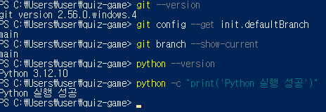
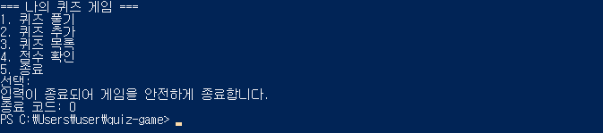
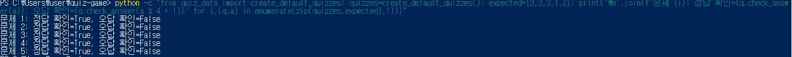
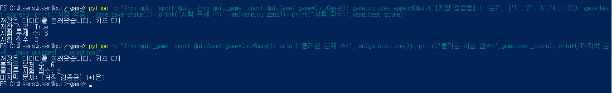
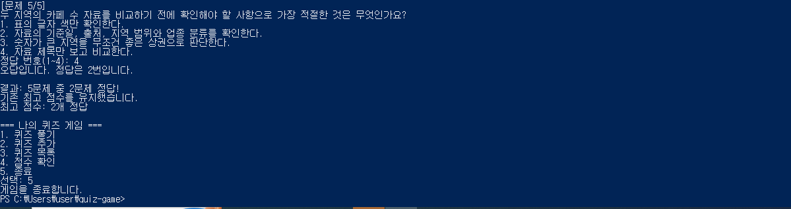
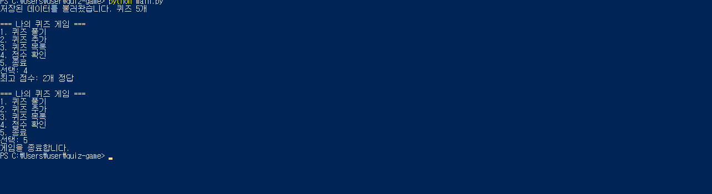
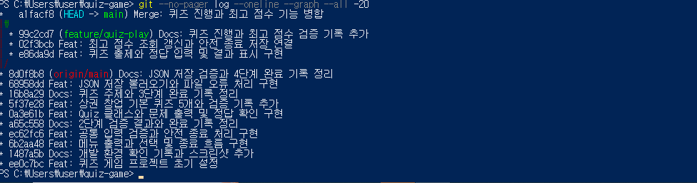
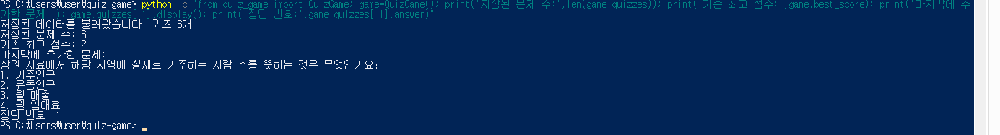
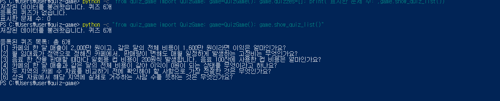

# Python 콘솔 퀴즈 게임

## 프로젝트 개요

코디세이 미션 2 과제로 만드는 Python 콘솔 퀴즈 게임입니다.
메뉴에서 퀴즈 풀기, 추가, 목록, 최고 점수 확인, 종료 기능을 선택하도록 개발합니다.

## 현재 진행 상태

- [x] Python 설치와 실행 확인
- [x] Git 버전 확인
- [x] 프로젝트 폴더 준비
- [x] .gitignore 작성
- [x] Git 저장소 초기화
- [x] GitHub 연결과 첫 업로드
- [ ] 퀴즈 게임 구현

## 개발 환경

- 운영체제: Windows 10 Pro
- 쉘: Windows PowerShell
- Python: 3.12.10
- Git: 2.56.0.windows.4
- 외부 라이브러리 없이 Python 표준 라이브러리로 개발 예정

## 퀴즈 주제와 선정 이유

주제: 상권 및 창업 기초 상식

선정 이유: 앞으로 상권분석과 창업 타당성 분석 프로그램을 만들고 싶어 관련 기초 개념을 익히기 위해 선택했습니다.

## 실행 방법

아직 프로그램을 구현하지 않았습니다.
구현 후 실제 실행 방법을 기록합니다.

## 구현할 기능

- 메뉴와 입력 오류 처리
- 퀴즈 풀기
- 퀴즈 추가와 목록 확인
- 최고 점수 확인과 갱신
- state.json 저장과 불러오기
- 파일 오류 처리와 안전 종료

## 현재 파일 구조

```text
quiz-game/
├─ .gitignore
└─ README.md
```

## 데이터 파일 계획

퀴즈와 최고 점수는 프로젝트 루트의 state.json에 UTF-8로 저장하고 불러옵니다.
quizzes는 문제 목록이며, best_score는 최고 정답 수입니다. 미플레이 상태는 null로 구분합니다. 저장과 복구 검증은 4단계 문서에 기록했습니다.
## 1단계 실행 증거

- 첫 커밋: ee0c7bc — 프로젝트 초기 설정
- 원격 저장소: https://github.com/dongsoo-seol/quiz-game
- 첫 푸시: main 브랜치 업로드 성공
- GitHub 웹에서 초기 파일 표시 확인
- 환경 사진 저장 및 내용 확인 완료



## 2단계 수행 결과

- 메뉴 선택반복종료 구현
- 공백문자빈 입력범위 밖 번호 처리 검증
- Ctrl+C와 EOF 안전 종료 검증
- 기본 메뉴 커밋: 6b2aa48
- 공통 입력예외 처리 커밋: ec62fc6
- GitHub에서 수행 문서와 사진 확인 완료
- 현재 퀴즈 관련 메뉴는 임시 안내이며 실제 기능은 후속 구현

[2단계 수행 기록](docs/02-menu-input.md)



## 3단계 수행 결과

- Quiz 클래스의 문제 출력과 정답 확인 구현
- 기본 퀴즈 5개, 선택지 각 4개, 정답 번호 1~4
- 문제 5개의 정답과 오답 판별 확인
- 클래스 커밋: 0a3e61b
- 기본 데이터 커밋: 5f37e28
- GitHub에서 문서와 사진 표시 확인
- 게임 진행 연결과 JSON 저장은 후속 구현

[3단계 수행 기록](docs/03-quiz-data.md)



## 4단계 수행 결과

- QuizGame 기본 구조와 JSON 저장 및 불러오기 구현
- 프로젝트 루트의 state.json을 UTF-8로 관리
- 파일 없음, 손상, 자료 오류, 읽기 및 쓰기 오류 처리 검증
- 자동 검증 7개 통과 및 종료 코드 0 확인
- 시험 문제와 점수의 재실행 후 유지 확인
- 검증 후 기본 문제 5개와 미플레이 상태로 복원
- 구현 및 검증 증거 커밋: 68958dd
- 실제 게임 진행과 종료 시 저장 연결은 후속 구현

[4단계 수행 기록](docs/04-state-storage.md)

[자동 검증 로그](docs/04-storage-test-log.txt)



## 5단계 수행 결과

- feature/quiz-play 브랜치에서 퀴즈 진행과 최고 점수 구현
- 정답 및 오답, 빈 퀴즈, 점수 갱신과 유지 검증
- 재실행 후 점수 유지와 Ctrl+C 및 EOF 안전 종료 확인
- 퀴즈 진행 커밋: e86da9d
- 최고 점수 커밋: 02f3bcb
- main 병합 커밋: a1facf8
- 병합된 main에서 점수 조회와 종료 확인
- 퀴즈 추가와 목록 메뉴는 다음 단계에서 구현

[5단계 수행 기록](docs/05-play-score-branch.md)







## 6단계 수행 결과

- 메뉴 2번: 문제와 선택지 4개, 정답 번호를 입력받아 저장
- 빈 내용, 공백, 잘못된 정답 입력 처리
- 추가 후 재실행에서도 문제 6개와 기존 최고 점수 2 유지
- 퀴즈 추가 자동 검증 6개 통과
- 메뉴 3번: 전체 문제 목록과 빈 목록 처리
- 추가 기능 커밋: 28dd48a
- 목록 기능 커밋: 204c96a
- 최종 클래스 정리와 통합 검증 및 clone, pull 실습은 후속 진행

[6단계 수행 기록](docs/06-add-list.md)

[퀴즈 추가 자동 검증 로그](docs/06-add-test-log.txt)




