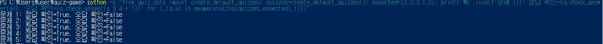

# 3단계. Quiz 클래스와 기본 문제

## 1. 수행 목표

Quiz 클래스로 개별 문제를 표현하고, 선택한 주제의 기본 문제 5개를 객체로 생성한다.

## 2. 학습 목표

- 클래스와 객체의 차이를 설명한다.
- __init__과 self의 역할을 이해한다.
- 속성과 메서드를 구분한다.
- list와 dict의 차이를 설명한다.
- 함수로 기본 퀴즈 객체 목록을 생성한다.

## 3. 퀴즈 주제와 선정 이유

주제: 상권·창업 기초 상식

선정 이유:
앞으로 상권분석·창업 타당성 분석 프로그램을 만들고 싶어,
관련 기초 개념을 퀴즈로 익히기 위해 선택했다.

문제 작성 과정:
선택한 주제에 맞춰 초안을 검토하고 문장·선택지·정답을 확정했다.
1번 문제는 매출과 비용 금액을 직접 변경하고 정답을 계산했다.

## 4. 파일별 역할

| 파일 | 역할 |
|---|---|
| quiz.py | 개별 문제를 표현하는 Quiz 클래스 |
| quiz_data.py | 기본 자료를 Quiz 객체 목록으로 만드는 함수 |
| main.py | 앞 단계의 메뉴·공통 입력·안전 종료 |

이번 단계에서는 기본 퀴즈를 main.py의 게임 진행 기능에 연결하지 않았다.
JSON 파일 저장은 후속 단계에서 구현한다.

## 5. Quiz 클래스

### 속성

| 속성 | 의미 |
|---|---|
| question | 문제 문자열 |
| choices | 선택지 4개를 담은 리스트 |
| answer | 정답 번호인 정수 1~4 |

### 메서드

| 메서드 | 역할 |
|---|---|
| __init__() | 입력 자료 검사와 객체 초기화 |
| display() | 문제와 선택지 출력 |
| check_answer() | 정답이면 True, 아니면 False 반환 |

### 생성 시 구현한 검사

- 문제는 비어 있지 않은 문자열이어야 한다.
- 선택지는 4개를 담은 리스트여야 한다.
- 각 선택지는 비어 있지 않은 문자열이어야 한다.
- 정답은 1~4 사이의 정수여야 한다.
- 문제와 선택지의 앞뒤 공백을 제거한다.

위 항목은 코드에 구현한 검사이다.
아래 실행 검증 결과와 구분하여 기록한다.

## 6. 기본 문제 구성

| 번호 | 내용 | 정답 번호 | 정답 내용 |
|---|---|---|---|
| 1 | 매출 2,000만 원에서 비용 1,600만 원 차감 | 3 | 400만 원 |
| 2 | 정액 월 임대료와 고정비 | 3 | 월 임대료 |
| 3 | 컵 비용 200원 × 100잔 | 3 | 20,000원 |
| 4 | 매출과 전체 비용이 같은 상태 | 1 | 손익분기점 |
| 5 | 상권 자료 비교 전 확인 사항 | 2 | 기준일·출처·지역 범위·업종 분류 |

기본 문제는 총 5개이며, 각 문제의 선택지는 4개이다.

## 7. list와 dict 활용

quiz_data는 문제 자료를 담은 리스트이다.

리스트 안의 각 딕셔너리는 다음 이름으로 값을 관리한다.

- question
- choices
- answer

create_default_quizzes()는 이 자료를 읽어 Quiz 객체를 생성하고,
생성된 객체를 담은 리스트를 반환한다.

클래스는 문제를 만드는 설계이고,
각 Quiz 객체는 문제·선택지·정답을 가진 개별 문제이다.

## 8. 문법과 클래스 기본 동작 검증

문법 확인:

```powershell
python -m py_compile quiz.py quiz_data.py
```

오류 출력 없이 입력 줄로 돌아왔다.

클래스 기본 동작 확인:

```powershell
python -c "from quiz import Quiz; q=Quiz('매출에서 비용을 뺀 금액은 무엇인가요?', ['이익', '매출', '고정비', '변동비'], 1); q.display(); print('정답 1 확인:', q.check_answer(1)); print('오답 2 확인:', q.check_answer(2))"
```

실제 결과:

```text
매출에서 비용을 뺀 금액은 무엇인가요?
1. 이익
2. 매출
3. 고정비
4. 변동비
정답 1 확인: True
오답 2 확인: False
```

이 문제는 클래스 검증용이며 기본 5문제와 별개이다.

## 9. 기본 데이터 검증

문제 수 확인:

```powershell
python -c "from quiz_data import create_default_quizzes; quizzes=create_default_quizzes(); print('기본 문제 수:', len(quizzes))"
```

실제 결과:

```text
기본 문제 수: 5
```

전체 문제를 조회하여 다음을 확인했다.

- 각 문제의 선택지 수: 4개
- 정답 번호 순서: 3, 3, 3, 1, 2

정답·오답 판별 확인:

```powershell
python -c "from quiz_data import create_default_quizzes; quizzes=create_default_quizzes(); expected=[3,3,3,1,2]; print('\n'.join(f'문제 {i}: 정답 확인={q.check_answer(a)}, 오답 확인={q.check_answer(a % 4 + 1)}' for i,(q,a) in enumerate(zip(quizzes,expected),1)))"
```

실제 결과:

```text
문제 1: 정답 확인=True, 오답 확인=False
문제 2: 정답 확인=True, 오답 확인=False
문제 3: 정답 확인=True, 오답 확인=False
문제 4: 정답 확인=True, 오답 확인=False
문제 5: 정답 확인=True, 오답 확인=False
```

각 문제에 예상 정답과 다른 번호 하나를 입력해 검증했다.
모든 오답 번호를 전수 검사했다고 기록하지 않는다.

## 10. 실행 증거

검증 사진을 저장한 뒤 직접 열어 내용을 확인했다.



## 11. 문제 해결

- 제공된 초안의 5번 문제에 섞인 한자 표기를 한국어로 수정했다.
- 긴 PowerShell 명령에서 닫는 큰따옴표가 빠져 추가 입력을 기다렸다.
- 닫는 큰따옴표를 입력한 뒤 정상 실행 결과를 확인했다.
- 프로그램 오류와 쉘 입력 대기 상태를 구분했다.

## 12. Git 기록과 진행 상태

클래스 구현 커밋:

```text
0a3e61b
Feat: Quiz 클래스와 문제 출력 및 정답 확인 구현
```

클래스 커밋의 GitHub 업로드를 확인했다.

- [x] Quiz 클래스 구현
- [x] 문제 출력·정답·오답 기본 검증
- [x] 클래스 별도 커밋·업로드
- [x] 기본 문제 5개 작성
- [x] 선택지 개수·정답 번호 확인
- [x] 전체 문제의 정답·오답 판별 검증
- [x] 검증 사진 저장·내용 확인
- [ ] 기본 데이터·문서·사진 커밋
- [ ] GitHub 업로드
- [ ] GitHub 문서·사진 표시 확인

기본 데이터 커밋과 업로드 결과는 실제 수행 후 추가한다.