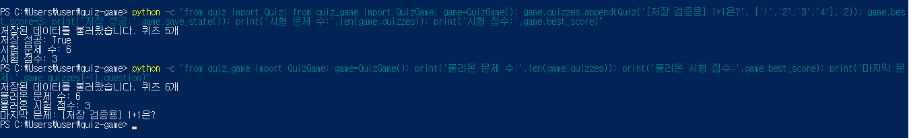

# 4단계. 게임 관리 기반과 JSON 저장·불러오기

## 1. 수행 목표

QuizGame의 기본 구조를 만들고, 퀴즈와 최고 점수를 프로젝트 루트의 state.json에 저장하고 불러온다.

파일 없음·손상·잘못된 자료·읽기·쓰기 오류를 처리하고, 재실행 후 데이터 유지를 검증한다.

## 2. 학습 목표

- 메모리에 있는 자료와 파일에 저장된 자료를 구분한다.
- Quiz 객체를 JSON 저장용 자료로 변환한다.
- JSON을 읽어 Quiz 객체로 복원한다.
- UTF-8 인코딩과 파일 경로를 이해한다.
- try/except로 파일 오류를 처리한다.
- 표준 라이브러리 unittest와 tempfile로 검증한다.

## 3. 사용 파일과 역할

| 파일 | 역할 |
|---|---|
| quiz_game.py | QuizGame 기본 구조·저장·불러오기 |
| quiz.py | 개별 문제 객체 |
| quiz_data.py | 기본 문제 5개 생성 |
| state.json | 프로젝트 루트의 실제 저장 파일 |
| test_storage.py | 임시 폴더를 사용하는 자동 검증 |
| docs/04-storage-test-log.txt | 자동 검증 실행 로그 |
| docs/screenshots/state-persistence.png | 재실행 후 유지 확인 사진 |

기존 main.py의 메뉴에는 아직 QuizGame을 연결하지 않았다.
실제 게임 진행·최고 점수 갱신은 후속 단계에서 구현한다.

## 4. QuizGame의 관리 자료

| 속성 | 의미 |
|---|---|
| quizzes | Quiz 객체 목록 |
| best_score | 최고 정답 수 또는 미플레이 상태 |
| state_path | 프로젝트 루트의 state.json 경로 |

best_score가 None이면 아직 완료한 게임 기록이 없는 상태이다.
JSON에서는 null로 저장된다.
완료한 게임의 0점과 구분한다.

## 5. 메서드 역할

| 메서드 | 역할 |
|---|---|
| __init__() | 파일 경로·기본 상태 준비 후 불러오기 |
| use_default_state() | 기본 문제 5개·미플레이 상태 준비 |
| load_state() | 파일 읽기·자료 검사·객체 복원 |
| save_state() | JSON 변환·UTF-8 저장 |

파일 위치는 quiz_game.py가 있는 폴더를 기준으로 정했다.

```python
Path(__file__).resolve().parent / "state.json"
```

## 6. 저장 파일 구조

아래는 필드 구조를 설명하는 축약 예시이다.
실제 기본 저장 파일에는 문제 5개가 있다.

```json
{
    "quizzes": [
        {
            "question": "문제 내용",
            "choices": ["보기 1", "보기 2", "보기 3", "보기 4"],
            "answer": 1
        }
    ],
    "best_score": null
}
```

- quizzes: 퀴즈 자료 목록
- question: 문제 문자열
- choices: 선택지 4개
- answer: 정답 번호인 정수 1~4
- best_score: 0 이상의 정수 또는 null

저장·읽기 인코딩은 UTF-8이다.
ensure_ascii=False로 한글을 읽기 쉬운 형태로 저장한다.

## 7. 저장 처리

1. Quiz 객체에서 문제·선택지·정답을 꺼낸다.
2. 최고 점수와 함께 딕셔너리로 구성한다.
3. json.dumps()로 JSON 문자열로 변환한다.
4. 임시 파일 state.json.tmp에 기록한다.
5. 기록 완료 후 실제 state.json으로 교체한다.

성공하면 True, 처리한 오류로 실패하면 False를 반환한다.
쓰기 실패를 저장 성공으로 표시하지 않는다.

## 8. 불러오기와 오류 처리

| 상황 | 구현한 처리 |
|---|---|
| 정상 파일 | 자료 검사 후 Quiz 객체로 복원 |
| 파일 없음 | 안내 후 기본 문제·미플레이 상태 사용 |
| JSON 손상 | 안내 후 기본 상태 복구 |
| 자료 구조·값 오류 | 안내 후 기본 상태 복구 |
| 읽기 오류 | 안내 후 기본 상태 복구 |
| 정상적인 빈 목록 | 퀴즈 0개로 정상 처리 |
| 쓰기 오류 | 안내 후 False 반환 |

복구는 먼저 메모리 안의 상태에 적용한다.
불러오기 실패만으로 기존 파일을 덮어쓰지 않는다.
이후 save_state()를 실행하면 현재 상태를 파일에 저장한다.

## 9. 정상 저장·불러오기 확인

문법 확인:

```powershell
python -m py_compile quiz_game.py
```

오류 없이 완료됐다.

기본 상태 저장 후 파일 내용을 확인했다.

```text
저장 성공: True
```

실제 state.json에서 문제 5개, 선택지·정답, 한글,
best_score의 null을 확인했다.

다시 실행해 불러온 결과:

```text
저장된 데이터를 불러왔습니다. 퀴즈 5개
불러온 문제 수: 5
최고 점수: None
첫 문제 객체: Quiz
```

## 10. 재실행 후 데이터 유지 검증

시험 전에 정상 state.json을 프로젝트 밖에 백업했다.

검증 순서:

1. 기본 문제 5개·미플레이 상태 백업
2. 저장 검증용 문제 1개 추가
3. 시험 점수 3 설정
4. 파일 저장
5. 별도 Python 실행에서 재불러오기
6. 결과 캡처
7. 백업본으로 원래 상태 복원

시험 점수는 저장 검증용이며 실제 게임 성적이 아니다.

저장 결과:

```text
저장 성공: True
시험 문제 수: 6
시험 점수: 3
```

별도 실행에서 불러온 결과:

```text
저장된 데이터를 불러왔습니다. 퀴즈 6개
불러온 문제 수: 6
불러온 시험 점수: 3
마지막 문제: [저장 검증용] 1+1은?
```

사진을 저장하고 직접 열어 내용을 확인했다.



백업본 복원 후 확인 결과:

```text
복원된 문제 수: 5
최고 점수: None
시험 문제 남음: False
```

## 11. 자동 검증

Python 표준 라이브러리 unittest와 tempfile을 사용했다.
시험 자료는 임시 폴더에 만들고 정상 state.json은 덮어쓰지 않았다.

실행 명령:

```powershell
python -m unittest -v test_storage
```

| 검증 메서드 | 확인 내용 |
|---|---|
| test_missing_file | 파일 없음 처리 |
| test_broken_json | 손상 JSON 복구·기존 시험 파일 내용 보존 |
| test_invalid_data | 구조·필수 키·선택지·정답·점수 오류 |
| test_empty_quizzes_and_zero_score | 빈 목록·None·0 처리 |
| test_read_error | 파일 경로가 디렉터리일 때 읽기 오류 처리 |
| test_write_error | 상위 폴더가 없는 경로의 쓰기 오류 처리 |
| test_save_and_reload | 저장·재불러오기·한글·객체·점수 유지 |

실제 실행 결과:

```text
Ran 7 tests in 0.084s

OK
```

읽기·쓰기 오류 안내는 의도적으로 만든 시험 상황이며,
예상대로 처리돼 검증은 통과했다.

## 12. 검증 로그 저장

검증 결과를 UTF-8 텍스트 파일로 저장했다.

```powershell
python -c "import subprocess,sys; f=open('docs/04-storage-test-log.txt','w',encoding='utf-8'); r=subprocess.run([sys.executable,'-X','utf8','-m','unittest','-v','test_storage'],stdout=f,stderr=subprocess.STDOUT); f.close(); print('검증 종료 코드:',r.returncode)"
```

실제 결과:

```text
검증 종료 코드: 0
```

저장된 파일에서 요약을 검색했다.

```powershell
Select-String -Path .\docs\04-storage-test-log.txt -Pattern '^Ran ','^OK$' -Encoding UTF8
```

확인된 내용:

```text
Ran 7 tests in 0.062s
OK
```

출력 경로와 버퍼링에 따라 요약이 파일 맨 끝에 있지 않을 수 있다.
종료 코드와 파일 안의 요약을 함께 확인했다.

[전체 자동 검증 로그](04-storage-test-log.txt)

## 13. 진행 상태

- [x] QuizGame 기본 구조
- [x] 루트 state.json 경로 지정
- [x] UTF-8 저장·불러오기
- [x] Quiz 객체 복원
- [x] 재실행 후 문제·시험 점수 유지
- [x] 시험 후 원래 자료 복원
- [x] 파일 없음·손상·잘못된 구조 처리 검증
- [x] 읽기·쓰기 오류 처리 검증
- [x] 빈 목록·0점 처리 검증
- [x] 자동 검증 7개 통과
- [x] 로그·사진 저장 및 확인
- [ ] 4단계 코드·자료·문서 커밋
- [ ] GitHub 업로드
- [ ] GitHub 문서·사진·로그 확인

실제 퀴즈 진행, 문제 추가 메뉴, 최고 점수 갱신,
종료 시 저장 연결은 후속 단계에서 구현·검증한다.