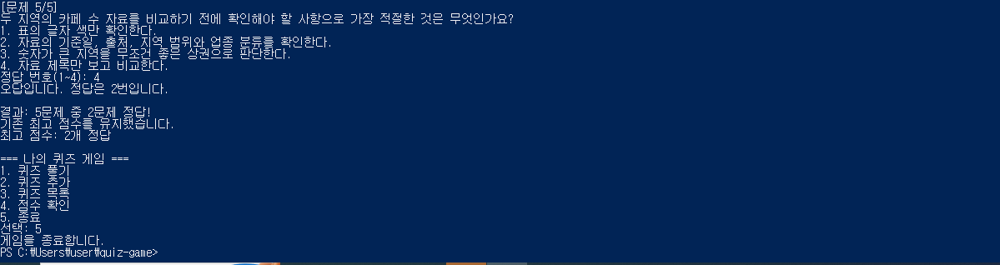
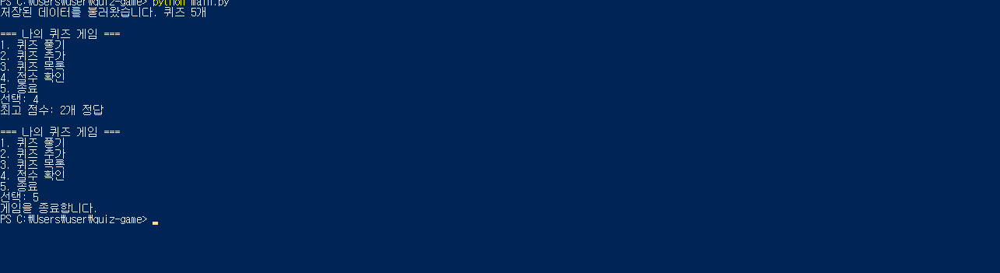
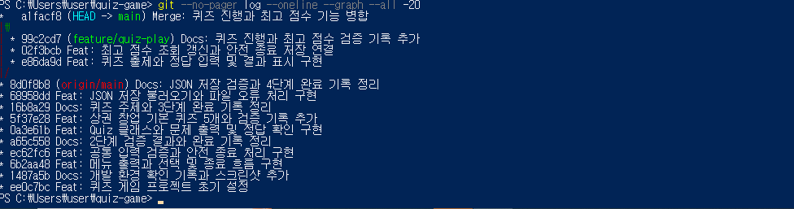

# 5단계. 브랜치에서 퀴즈 진행과 최고 점수 구현

## 1. 수행 목표

main과 구분된 브랜치에서 퀴즈 진행과 최고 점수 기능을 구현하고,
검증 후 main에 병합한다.

## 2. 학습 목표

- for로 퀴즈 목록을 순회한다.
- 공통 입력 함수를 다른 메서드에 전달한다.
- 이번 정답 수와 최고 정답 수를 구분한다.
- None과 0의 차이를 설명한다.
- finally를 사용해 종료 시 저장을 시도한다.
- 브랜치 작업과 병합의 차이를 이해한다.

## 3. 작업 환경과 브랜치

- Python 3.12.10
- Windows PowerShell
- 프로젝트: C:\Users\user\quiz-game
- 작업 브랜치: feature/quiz-play

작업 전 main이 원격과 일치하고 미커밋 변경이 없는 것을 확인했다.
별도 브랜치로 이동한 뒤 현재 브랜치 이름을 확인했다.

main 병합 커밋: a1facf8. 병합 후 점수 조회와 정상 종료를 확인했다.

## 4. 파일과 역할

| 파일 | 역할 |
|---|---|
| main.py | 메뉴·공통 입력·기능 연결·종료 처리 |
| quiz_game.py | 퀴즈 진행·최고 점수·저장·불러오기 |
| quiz.py | 개별 문제 출력·정답 판별 |
| quiz_data.py | 기본 문제 생성 |
| state.json | 문제와 최고 정답 수 저장 |

2번 퀴즈 추가와 3번 목록 메뉴는 아직 임시 안내이다.
해당 기능은 다음 단계에서 구현한다.

## 5. 퀴즈 진행

play_quizzes(read_number)의 처리 순서:

1. 퀴즈가 없으면 안내하고 None 반환
2. 이번 게임의 정답 수를 0으로 준비
3. 저장된 문제를 순서대로 출력
4. 공통 입력 함수로 1~4 번호 입력
5. 정답·오답 안내와 정답 수 계산
6. 모든 문제 완료 후 결과 출력
7. 완료한 정답 수 반환

main.py에서 기존 read_int 함수를 전달한다.
따라서 메뉴와 정답 입력에 같은 숫자 검증을 재사용한다.

## 6. 최고 점수 처리

이번 프로그램의 점수 단위는 정답 개수이다.
백분율 점수가 아니다.

| 상태 | 의미 |
|---|---|
| best_score가 None | 완료한 게임 기록 없음 |
| best_score가 0 | 완료했지만 모두 오답 |
| best_score가 양의 정수 | 저장된 최고 정답 수 |

show_best_score():
미플레이 안내 또는 최고 정답 수를 표시한다.

update_best_score(correct_count):
첫 완료 기록이나 더 높은 점수면 갱신한다.
낮거나 같은 점수면 기존 최고 점수를 유지한다.
파일 저장 성공 여부를 확인해 안내한다.

퀴즈가 없어 반환한 None은 완료 점수로 기록하지 않는다.
완료한 0점은 정상 점수로 기록한다.

## 7. 종료 시 저장

main()의 finally에서 save_state()를 호출한다.

- 메뉴의 5번 정상 종료
- 게임 입력 중 Ctrl+C
- 입력 스트림 종료

저장 실패 시에는 실패 안내를 출력한다.
중도 중단한 게임은 완료 결과를 반환하지 않으므로
최고 점수 갱신 대상으로 사용하지 않는다.

## 8. 실제 퀴즈 진행 검증

| 검증 | 입력·관찰 | 실제 결과 |
|---|---|---|
| 모두 정답 | 3, 3, 3, 1, 2 | 5문제 중 5개 정답 |
| 일부 정답 | 4번 문제만 정답 | 5문제 중 1개 정답 |
| 모두 오답 | 모든 문제에 4 입력 | 5문제 중 0개 정답 |
| 범위 밖 답 | 5 입력 | 안내 후 재입력 |
| 퀴즈 없음 | 메모리 목록만 비움 | 안내 후 None 반환 |

이 중 전체 5개 정답·일부 정답·모두 오답의 초기 검증은
최고 점수 연결 전에 수행했다.

빈 목록 검증 명령:

```powershell
python -c "from quiz_game import QuizGame; from main import read_int; game=QuizGame(); game.quizzes=[]; print('진행 결과:',game.play_quizzes(read_int))"
```

실제 출력의 핵심:

```text
등록된 퀴즈가 없습니다.
진행 결과: None
```

이 검증은 실제 파일의 문제 목록을 비우지 않았다.

## 9. 실제 최고 점수 검증

| 순서 | 수행 내용 | 실제 결과 |
|---|---|---|
| 1 | 게임 완료 전 4번 메뉴 | 완료 기록 없음 안내 |
| 2 | 첫 게임을 모두 오답으로 완료 | 최고 점수 0 저장 |
| 3 | 종료 후 재실행·4번 조회 | 최고 점수 0 유지 |
| 4 | 2개 정답으로 완료 | 최고 점수 0에서 2로 갱신 |
| 5 | 1개 정답으로 완료 | 기존 최고 점수 2 유지 |
| 6 | 메뉴 4번 조회 | 최고 점수 2 표시 |
| 7 | 퀴즈 도중 Ctrl+C 후 파일 재조회 | 문제 5개·최고 점수 2 유지 |

낮은 점수 게임의 실제 출력 발췌:

```text
결과: 5문제 중 1문제 정답!
기존 최고 점수를 유지했습니다.
최고 점수: 2개 정답
```

조회 결과:

```text
선택: 4
최고 점수: 2개 정답
```

## 10. 안전 종료 검증

### Ctrl+C

메뉴 대기와 문제의 정답 입력 대기에서 각각 확인했다.

정답 입력 중 실제 출력:

```text
정답 번호(1~4):
입력이 취소되어 게임을 안전하게 종료합니다.
```

중단 후 별도 실행에서 확인했다.

```text
저장된 문제 수: 5
저장된 최고 점수: 2
```

### EOF

메뉴 선택 1만 전달하고 첫 문제에서 입력을 종료했다.

```powershell
python -c "import subprocess,sys; r=subprocess.run([sys.executable,'-X','utf8','main.py'],input='1\n',capture_output=True,text=True,encoding='utf-8'); print(r.stdout,end=''); print(r.stderr,end=''); print('종료 코드:',r.returncode)"
```

실제 출력의 핵심:

```text
정답 번호(1~4):
입력이 종료되어 게임을 안전하게 종료합니다.
종료 코드: 0
```

## 11. 기존 저장 기능 확인

퀴즈 진행 연결 후 기존 자동 검증을 실행했다.

```powershell
python -m unittest -v test_storage
```

실제 결과:

```text
Ran 7 tests in 0.096s

OK
```

이는 퀴즈 진행 연결 후, 최고 점수 기능을 추가하기 전에
실행한 저장 기능 회귀 검증 기록이다.

## 12. 문제 해결 기록

### 브랜치 이름을 명령으로 입력

브랜치 조회 결과를 다시 명령처럼 입력해 오류가 발생했다.
조회 결과와 실행할 명령을 구분했다.
브랜치 자체는 정상적으로 유지됐다.

### QuizGame 가져오기 실패

함수 추가 과정에서 quiz_game.py에 새 함수만 남아
QuizGame 클래스를 가져오지 못했다.

- 현재 함수를 프로젝트 밖에 백업
- Git의 마지막 커밋에서 quiz_game.py 복원
- 클래스 존재 확인
- 백업 함수를 클래스 안에 추가
- 저장·불러오기·퀴즈 진행 메서드 존재 확인
- 실제 퀴즈 실행과 기존 저장 검증으로 재확인

문법 검사 성공만으로 필요한 클래스까지 존재한다고
보장되는 것은 아님을 확인했다.

## 13. 실행 화면

사진을 저장하고 직접 열어 내용을 확인했다.

### 퀴즈 플레이



### 최고 점수 조회



## 14. 기능별 커밋

```text
e86da9d
Feat: 퀴즈 출제와 정답 입력 및 결과 표시 구현
```

```text
02f3bcb
Feat: 최고 점수 조회 갱신과 안전 종료 저장 연결
```

두 기능을 feature/quiz-play 브랜치에서 별도 커밋으로 기록했다.

## 15. 진행 상태

- [x] 별도 브랜치 작업
- [x] 퀴즈 출제·정답 입력·정답/오답 안내
- [x] 완료 결과와 빈 퀴즈 처리
- [x] 최고 점수 조회·비교·갱신·저장
- [x] 미플레이와 완료한 0점 구분
- [x] 재실행 후 점수 유지
- [x] Ctrl+C·EOF 안전 종료 확인
- [x] 기능별 커밋
- [x] 플레이·점수 사진 저장·내용 확인
- [x] 문서·사진 커밋
- [x] main 병합과 병합 기록 확인
- [x] main에서 실행 확인
- [ ] GitHub 업로드·웹 표시 확인

남은 항목은 실제 수행 후 결과와 함께 갱신한다.

## 16. 병합 확인 기록

- 검증 문서와 사진 커밋: 99c2cd7
- 병합 커밋: a1facf8
- main에서 최고 점수 2 조회 및 정상 종료 확인
- Git 그래프 사진 저장 및 내용 확인


