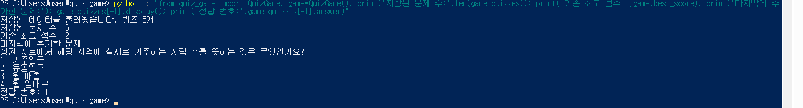
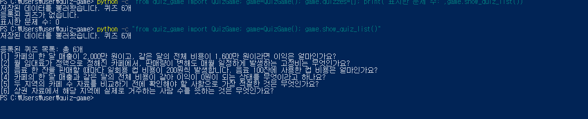

# 6단계. 퀴즈 추가와 목록

## 1. 수행 목표

사용자가 새로운 퀴즈를 등록하고 파일에 저장하며,
저장된 문제 목록을 확인할 수 있게 한다.

## 2. 학습 목표

- 입력값을 검증한 뒤 Quiz 객체를 생성한다.
- list에 객체를 추가한다.
- 입력 중단과 저장 실패를 구분한다.
- enumerate()로 문제 번호와 제목을 표시한다.
- 정상 목록과 빈 목록을 처리한다.
- 임시 폴더와 모의 입력으로 기능을 검증한다.

## 3. 사용 파일

| 파일 | 역할 |
|---|---|
| main.py | 메뉴 2번·3번을 실제 기능에 연결 |
| quiz_game.py | 내용 입력·추가·저장·목록 메서드 |
| state.json | 추가 문제와 최고 점수 보존 |
| test_add_quiz.py | 퀴즈 추가 자동 검증 |
| docs/06-add-test-log.txt | 자동 검증 로그 |
| docs/screenshots/add_quiz.png | 추가 후 재실행 확인 |
| docs/screenshots/list.png | 목록 표시 확인 |

## 4. 퀴즈 추가 구현

### read_nonempty_text(prompt)

- 입력 앞뒤 공백 제거
- 빈 입력·공백만 있는 입력 안내
- 올바른 내용이 들어올 때까지 재입력
- 검증한 문자열 반환

### add_quiz(read_number)

1. 문제 입력
2. 선택지 4개 입력
3. 공통 숫자 함수로 정답 1~4 입력
4. 모든 입력이 끝나면 Quiz 객체 생성
5. 퀴즈 목록에 추가
6. state.json 저장
7. 저장 성공·실패에 맞게 안내

입력 중 중단되면 아직 목록에 추가하지 않았으므로
불완전한 문제가 등록되지 않는다.

save_state()가 False를 반환하면 방금 추가한 문제를 목록에서 제거하고,
등록 취소를 안내한다.

## 5. 실제 등록한 문제

문제:
상권 자료에서 해당 지역에 실제로 거주하는 사람 수를 뜻하는 것은 무엇인가요?

1. 거주인구
2. 유동인구
3. 월 매출
4. 월 임대료

정답 번호: 1

검증 전 정상 state.json을 프로젝트 밖에 백업했다.

## 6. 수동 입력과 저장 검증

| 항목 | 실제 결과 |
|---|---|
| 빈 문제 | 안내 후 재입력 |
| 정답 abc | 숫자 입력 안내 |
| 빈 정답 | 빈 입력 안내 |
| 정답 0 | 범위 안내 |
| 정답 5 1 | 숫자 변환 실패 안내 |
| 정답 1 | 문제 등록·저장 성공 |

5 1은 두 숫자가 함께 입력된 문자열이다.
단독 5의 범위 검증과 구분했다.
단독 5 및 빈 선택지는 아래 자동 검증에서 확인했다.

등록 결과:

```text
퀴즈를 추가하고 파일에 저장했습니다.
등록된 퀴즈: 6개
```

종료 후 별도 실행에서 확인한 결과:

```text
저장된 문제 수: 6
기존 최고 점수: 2
```

추가한 문제·선택지 4개·정답 번호 1도 확인했다.
기존 문제와 최고 점수가 유지됐다.

## 7. 추가 자동 검증

실제 데이터를 보호하기 위해 tempfile의 임시 폴더를 사용했다.
unittest와 unittest.mock은 Python 표준 라이브러리이다.

실행 명령:

```powershell
python -m unittest -v test_add_quiz
```

| 검증 | 확인 내용 |
|---|---|
| 정상 추가·재불러오기 | 문제 저장·객체 복원·기존 점수 유지 |
| 빈 내용·공백·잘못된 정답 | 재입력·공백 제거·정답 범위 확인 |
| 입력 중 KeyboardInterrupt | 예외 전달·미완성 문제 미등록·자료 유지 |
| 입력 중 EOFError | 예외 전달·미완성 문제 미등록·자료 유지 |
| 저장 실패 | False 반환 시 목록 추가 취소 |
| 연속 추가 | 문제별 선택지 구분·파일 반영 |

저장 실패 검증은 save_state()가 False를 반환하도록 모의 처리했다.
실제 운영체제의 쓰기 오류를 이번 검증에서 발생시켰다는 뜻은 아니다.

취소 검증은 add_quiz 메서드의 예외 전달과 자료 유지를 확인한 것이다.
프로그램 전체의 종료 안내 검증과 구분한다.

실제 결과:

```text
Ran 6 tests in 0.159s

OK
```

임시 폴더의 문제 수 7개 출력은 시험 자료이며,
프로젝트의 실제 문제 수 증가를 뜻하지 않는다.

## 8. 자동 검증 로그 저장

검증 출력을 UTF-8로 저장했다.

```powershell
python -c "import subprocess,sys; f=open('docs/06-add-test-log.txt','w',encoding='utf-8'); r=subprocess.run([sys.executable,'-X','utf8','-m','unittest','-v','test_add_quiz'],stdout=f,stderr=subprocess.STDOUT); f.close(); print('검증 종료 코드:',r.returncode)"
```

실제 결과:

```text
검증 종료 코드: 0
```

로그에서 확인한 요약:

```text
Ran 6 tests in 0.069s
OK
```

[전체 추가 검증 로그](06-add-test-log.txt)

## 9. 퀴즈 목록 구현

show_quiz_list()는 다음을 수행한다.

- 전체 문제 수 표시
- enumerate()로 1번부터 번호와 문제 제목 표시
- 빈 목록이면 안내 후 0 반환
- 정상 목록이면 표시한 문제 수 반환

목록 메서드는 파일에 자료를 저장하거나 변경하지 않는다.
메뉴 종료 시에는 기존 finally의 저장 처리가 실행된다.

메뉴 3번에서 실제 확인한 결과:

```text
등록된 퀴즈 목록: 총 6개
```

문제 번호 [1]~[6]과 마지막 거주인구 문제를 확인했다.
조회 후 메뉴 복귀·정상 종료도 확인했다.

## 10. 빈 목록 검증

실제 파일을 변경하지 않고 메모리의 목록만 비웠다.

```powershell
python -c "from quiz_game import QuizGame; game=QuizGame(); game.quizzes=[]; print('표시한 문제 수:',game.show_quiz_list())"
```

실제 결과:

```text
등록된 퀴즈가 없습니다.
표시한 문제 수: 0
```

이 명령은 저장하지 않았으므로 실제 문제 6개는 유지됐다.

## 11. 실행 사진

사진을 저장한 뒤 각각 열어 내용을 확인했다.

### 추가 후 재실행 확인

새 문제 입력 과정 자체가 아닌,
추가한 문제와 기존 점수의 재불러오기 화면이다.



### 목록 조회



## 12. Git 기록

추가 기능 커밋과 업로드:

```text
28dd48a
Feat: 퀴즈 추가와 입력 검증 및 저장 구현
```

목록 기능 커밋과 업로드:

```text
204c96a
Feat: 퀴즈 목록 조회와 빈 목록 처리 구현
```

두 기능은 main에서 각각 별도 커밋으로 기록했다.

## 13. 진행 상태

- [x] 문제·선택지 4개·정답 입력
- [x] 빈 내용·공백·잘못된 정답 처리
- [x] 추가 문제 저장·재실행 유지
- [x] 기존 최고 점수 유지
- [x] 중단·저장 실패 처리 자동 검증
- [x] 목록·빈 목록 표시
- [x] 추가·목록 각각 커밋·업로드
- [x] 사진·자동 검증 로그 저장
- [x] 6단계 문서와 README 정리·업로드
- [x] GitHub 문서·사진·로그 표시 확인

클래스 구조 최종 정리와 전체 요구사항 통합 검증,
clone·pull 실습은 후속 단계에서 수행한다.

## 14. 업로드 확인

- 수행 문서와 README 커밋: 7c90389
- GitHub에서 6단계 문서, 사진, 검증 로그, README 표시 확인 완료
