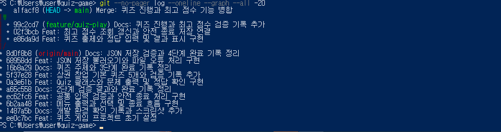

# 7단계. 클래스 구조 정리와 전체 요구사항 검증

## 1. 수행 목표

Quiz와 QuizGame의 역할을 정리하고,
메뉴부터 저장·재실행까지 연결된 프로그램을 검증한다.
필수 제출 내용이 README에서 확인되도록 정리한다.

## 2. 학습 목표

- 클래스의 속성과 메서드를 구분한다.
- 기능별 책임을 나누는 이유를 설명한다.
- 메서드 검증과 전체 프로그램 검증을 구분한다.
- 실제 결과를 근거로 요구사항 충족 여부를 기록한다.

## 3. 개발 환경

- Windows 10 Pro
- Windows PowerShell
- Python 3.12.10
- Git 2.56.0.windows.4
- 외부 라이브러리 사용 없음
- json, pathlib, unittest, tempfile, subprocess 등 표준 라이브러리 사용

## 4. 최종 코드 역할

| 파일 | 역할 |
|---|---|
| main.py | 공통 숫자 입력·프로그램 시작·중단 안내 |
| quiz.py | 개별 문제 자료·출력·정답 판별 |
| quiz_data.py | 기본 퀴즈 객체 5개 생성 |
| quiz_game.py | 메뉴·게임 진행·추가·목록·점수·저장 관리 |
| state.json | 문제 목록·최고 정답 수 저장 |

검증 코드는 test_storage.py, test_add_quiz.py,
test_console.py로 구분했다.

## 5. 클래스 구조 정리

### Quiz

속성:

- question
- choices
- answer

역할:

- 생성 시 문제 자료 검사
- 문제와 선택지 출력
- 정답 판별

### QuizGame

속성:

- quizzes
- best_score
- state_path

주요 메서드:

- use_default_state()
- load_state()
- save_state()
- play_quizzes()
- show_best_score()
- update_best_score()
- read_nonempty_text()
- add_quiz()
- show_quiz_list()
- show_menu()
- run()

메뉴 출력과 전체 진행을 main.py에서 QuizGame으로 옮겼다.
main.py는 공통 숫자 입력과 실행 진입점 역할을 유지했다.

구조 정리 커밋:

```text
b76b7e9
Refactor: 메뉴와 게임 진행 책임을 QuizGame으로 이동
```

## 6. 구조 변경 후 기존 검증

```powershell
python -m unittest -v test_storage test_add_quiz
```

실제 결과:

```text
Ran 13 tests in 0.225s

OK
```

실제 메뉴에서도 문제 6개 목록, 최고 점수 2 조회,
정상 종료를 확인했다.

## 7. 전체 프로그램 검증 방법

test_console.py는 프로그램 파일을 임시 폴더에 복사하고
그곳의 main.py를 별도 Python 프로세스로 실행한다.

시험용 state.json은 임시 폴더에 생성한다.
프로젝트의 실제 문제 6개와 최고 점수 2는 변경하지 않는다.

KeyboardInterrupt 자동 검증은 예외를 모의 발생시킨다.
실제 키 입력 검증과 구분한다.

## 8. 전체 프로그램 검증 항목

| 항목 | 검증 내용 |
|---|---|
| 첫 실행 | 파일 없을 때 기본 문제 사용·종료 시 저장 |
| JSON 손상 | 안내·기본 상태 복구 |
| 자료 구조 오류 | 안내·기본 상태 복구 |
| 메뉴 입력 | 공백·문자·빈 입력·범위 밖 숫자 |
| 정답 입력 | 공통 입력 검증·정답 수 계산 |
| 첫 0점 | 미플레이와 구분·저장·재실행 |
| 최고 점수 | 낮은 점수·동점 유지·높은 점수 갱신 |
| 추가 연계 | 추가·목록·재실행·추가 문제 출제 |
| 빈 목록 | 목록·플레이 안내, 미플레이 유지 |
| EOF | 메뉴·퀴즈·추가 도중 종료·기존 자료 유지 |
| KeyboardInterrupt | 모의 중단 처리·미완성 자료 미등록 |
| 종료 시 저장 실패 | 안내 후 종료 |
| 다른 작업 폴더 | 프로젝트 루트의 저장 파일 사용 |

실행:

```powershell
python -m unittest -v test_console
```

실제 결과:

```text
Ran 13 tests in 4.417s

OK
```

## 9. 전체 자동 검증과 로그

저장 검증 7개, 추가 검증 6개, 전체 실행 검증 13개를 함께 실행했다.

```powershell
python -m unittest -v test_storage test_add_quiz test_console
```

제출용 로그 저장에 사용한 명령:

```powershell
python -c "import subprocess,sys; f=open('docs/07-all-tests-log.txt','w',encoding='utf-8'); r=subprocess.run([sys.executable,'-X','utf8','-m','unittest','-v','test_storage','test_add_quiz','test_console'],stdout=f,stderr=subprocess.STDOUT); f.close(); print('검증 종료 코드:',r.returncode)"
```

실제 결과:

```text
검증 종료 코드: 0
Ran 26 tests in 4.093s
OK
```

[전체 자동 검증 로그](07-all-tests-log.txt)

test_read_error와 test_write_error는 검증 이름이다.
이름에 error가 있어도 결과가 ok이면 실패가 아니다.

## 10. 요구사항별 확인

| 요구사항 | 구현·검증 위치 |
|---|---|
| Python 3.10 이상 | 01-setup.md |
| 외부 라이브러리 미사용 | 소스와 검증 코드의 표준 라이브러리 |
| 메뉴·입력·종료 | main.py의 read_int, QuizGame의 show_menu와 run |
| 공백·문자·범위·빈 입력 | read_int, read_nonempty_text, 자동 검증 |
| Ctrl+C·EOF | 실행 진입점·finally 저장·수동 및 자동 검증 |
| Quiz 필수 속성·메서드 | quiz.py |
| 기본 문제 5개 이상·보기 4개 | quiz_data.py, 03-quiz-data.md |
| 브랜치에서 퀴즈 풀기 | 05-play-score-branch.md |
| 추가·목록·빈 목록 | QuizGame, 06-add-list.md |
| 최고 점수·미플레이·0점 | QuizGame, 05-play-score-branch.md, 전체 검증 |
| 루트 state.json·UTF-8 | QuizGame의 파일 경로·저장·불러오기 |
| 파일 없음·손상·읽기·쓰기 오류 | test_storage.py, test_console.py |
| 클래스 2개 이상·기능 분리 | Quiz, QuizGame과 메서드 목록 |
| 기능별 커밋·메시지 | Git 이력 |
| clone·pull | 8단계에서 수행 예정 |

## 11. 점수와 저장 데이터의 해석

점수 단위는 한 게임에서 맞힌 문제 수이다.

- null: 아직 완료 기록 없음
- 0: 완료했지만 모두 오답
- 양의 정수: 저장된 최고 정답 수

문제 수가 늘어날 수 있으므로 백분율 점수와 혼동하지 않는다.

현재 실제 저장 자료는 사용자 실행 결과인 문제 6개·최고 점수 2이다.
파일이 없거나 손상되면 기본 문제 5개·미플레이 상태로 시작한다.

자동 검증은 임시 자료를 사용하므로 실제 저장 자료와 구분한다.

## 12. Git 요구사항 확인

커밋 수 확인:

```powershell
git rev-list --count HEAD
```

이번 점검 시점의 실제 결과:

```text
21
```

이는 점검 시점의 값이며 이후 문서·검증 커밋으로 증가할 수 있다.
기능·수정·문서·구조 정리 내용을 나누어 커밋했다.

- init, add, commit, push: 앞 단계에서 실제 사용
- checkout: feature/quiz-play 생성·이동 및 main 복귀
- merge: 별도 브랜치 작업을 main에 병합
- clone, pull: 8단계 미수행

병합 커밋: a1facf8



이 사진은 5단계에서 촬영한 당시 이력이다.

## 13. 실행 증거 위치

| 내용 | 문서·사진 |
|---|---|
| 환경 | 01-setup.md, screenshots/environment.png |
| 메뉴·입력 | 02-menu-input.md, screenshots/menu.png |
| 클래스·기본 문제 | 03-quiz-data.md, screenshots/quiz-data.png |
| 저장·재실행 | 04-state-storage.md, screenshots/state-persistence.png |
| 플레이·점수 | 05-play-score-branch.md, screenshots/play.png, screenshots/score.png |
| 추가·목록 | 06-add-list.md, screenshots/add_quiz.png, screenshots/list.png |

각 단계의 문서에서 실제 명령·출력과 사진을 확인한다.

## 14. 진행 상태

- [x] QuizGame으로 메뉴·진행 책임 정리
- [x] 구조 정리 별도 커밋·업로드
- [x] 기존 검증 13개 통과
- [x] 실제 메뉴 조회·종료 확인
- [x] 전체 실행 검증 13개 통과
- [x] 전체 자동 검증 26개 통과·로그 저장
- [x] 커밋 수 점검
- [ ] 최종 README 작성
- [ ] 전체 검증 코드·로그·문서 업로드
- [ ] GitHub 표시 확인

8단계의 clone·pull 실습과 최종 제출은 아직 남아 있다.